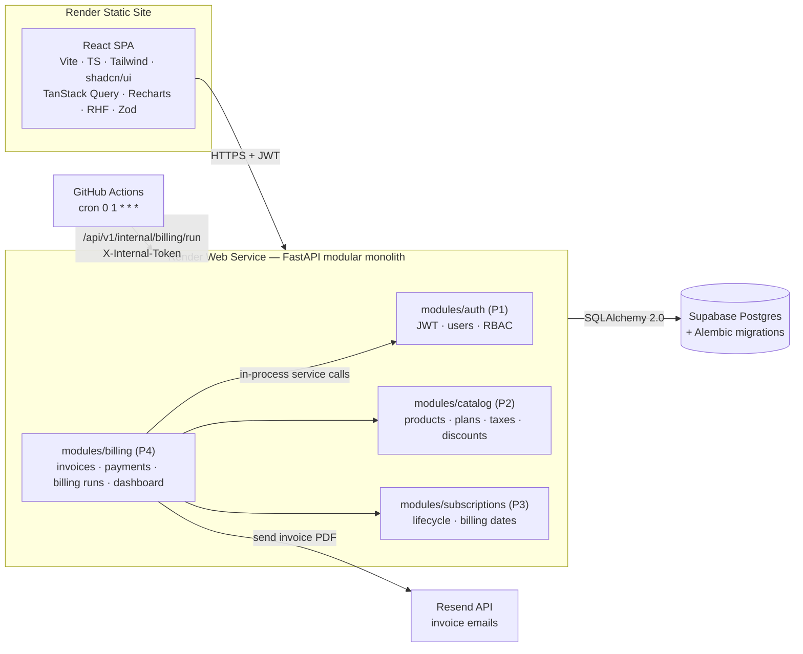
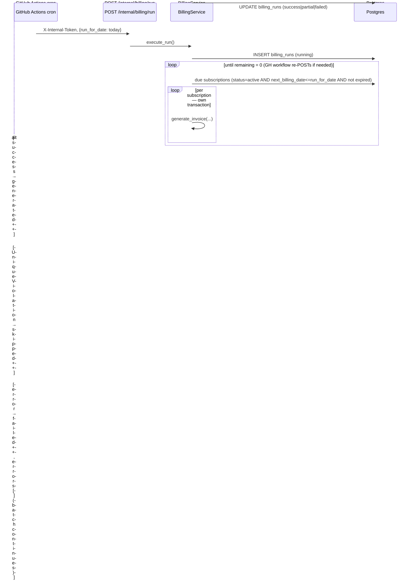
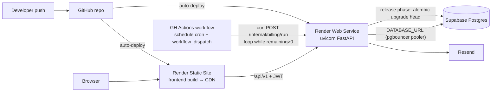

# Billing, Payments & Finance Dashboard — Technical Architecture

**Module owner:** Person 4 — Invoice management, recurring billing, payment tracking, overdue management, finance dashboard.

**System:** Brightloop Subscription Management System — modular monolith (React SPA + FastAPI + Supabase Postgres).

> All interfaces touching other modules are tagged **[PROPOSED]** and need team agreement before implementation.

---

## 1. Architecture Overview

Single **modular monolith**: one FastAPI app with four internal modules (`auth` P1, `catalog` P2, `subscriptions` P3, `billing` P4), one shared Supabase Postgres, one Alembic migration tree. Cross-module communication is **in-process service calls inside shared DB transactions** — not HTTP. Only the frontend and GitHub Actions cross the network boundary.

Key design decisions:

- React SPA talks to `GET/POST /api/v1/**` with a JWT bearer token issued by P1's auth module.
- GitHub Actions cron calls `POST /api/v1/internal/billing/run` authenticated with a shared `X-Internal-Token` secret — no Redis/Celery/worker needed.
- Money is `NUMERIC(14,2)` in the DB and `Decimal` end-to-end in Python/Pydantic. Never float.
- Invoice lines are **immutable price snapshots** — they never re-read live product prices after creation. This protects historical invoices when P2 changes prices.
- Idempotency is enforced in the DB, not in application memory: unique constraints on `(subscription_id, period_start, period_end)` and `payments.idempotency_key`.
- All financial calculation happens in the backend. The frontend renders and filters only.

## 2. High-Level Diagram



## 3. Component Responsibilities (billing module)

| Component | Responsibility |
|---|---|
| `router_invoices.py` | Invoice CRUD + lifecycle endpoints (confirm, cancel, PDF, email) |
| `router_payments.py` | Payment recording, listing, voiding |
| `router_billing.py` | Manual billing runs, run history, due-preview; also serves the `/internal` GitHub Actions endpoint |
| `router_dashboard.py` | Summary KPIs, revenue trend, recent payments, overdue list |
| `service_billing.py` | `BillingService` — invoice generation, batch run orchestration |
| `service_payments.py` | `PaymentService` — recording, voiding, invoice balance reconciliation |
| `service_dashboard.py` | Aggregate queries for dashboard |
| `repository.py` | Filtered/paginated list queries, dashboard SQL |
| `models.py` | SQLAlchemy models for the 5 tables below |
| `schemas.py` | Pydantic v2 request/response DTOs (`Decimal` fields) |
| `numbering.py` | Invoice/payment number allocation via `number_counters` row locks |
| `pdf.py` | ReportLab invoice PDF rendering (generated on demand, not stored) |
| `emails.py` | Resend client — send invoice email with PDF attachment |
| `integrations.py` | Protocol/ABC definitions for the P1–P3 contracts consumed by this module |

Frontend feature slices (under `frontend/src/features/`): `invoices/` (list, detail, confirm/cancel, PDF/email actions), `payments/` (record-payment form, payment history), `billing/` (run-now button, run history, due preview), `dashboard/` (KPI cards, Recharts trend, filters). Shared: `api/client.ts` typed fetch wrapper, OpenAPI-inferred types, TanStack Query hooks per feature.

## 4. Database Design

Only P4 tables are specified. `users`, `customers`, `products`, `subscription_lines`, `subscriptions` are owned by P1/P2/P3 — shown as opaque FK targets. **[PROPOSED]** the referenced table/column names.

### `invoices`

| Column | Type | Notes |
|---|---|---|
| id | uuid PK | `gen_random_uuid()` |
| invoice_number | varchar(20) | UNIQUE, e.g. `INV-2026-000042`; assigned at creation, retained on cancel (no gaps) |
| subscription_id | uuid FK → subscriptions.id | NULL allowed (ad-hoc invoices) |
| customer_id | uuid FK → customers.id | NOT NULL |
| status | enum `invoice_status` | `draft` / `confirmed` / `paid` / `cancelled`. Partially-paid is derived: `confirmed` with `0 < amount_paid < total_amount` |
| issue_date | date | NOT NULL |
| due_date | date | NOT NULL |
| period_start, period_end | date | NOT NULL — the billed period |
| currency | char(3) | default `'INR'` **[PROPOSED — team pick]** |
| subtotal | numeric(14,2) | sum of line pre-tax amounts |
| tax_total | numeric(14,2) | default 0 |
| discount_total | numeric(14,2) | default 0 |
| total_amount | numeric(14,2) | CHECK `total_amount = subtotal + tax_total - discount_total` |
| amount_paid | numeric(14,2) | default 0; maintained transactionally by payment writes — denormalized so outstanding = `total_amount - amount_paid` needs no join |
| notes | text | |
| billing_run_id | uuid FK → billing_runs.id | NULL = manually generated — traceability |
| last_emailed_at | timestamptz | |
| created_by | uuid FK → users.id | |
| created_at, updated_at, confirmed_at, cancelled_at | timestamptz | |

Constraints/indexes:

- `UNIQUE (subscription_id, period_start, period_end)` — the anti-duplicate guarantee for recurring billing (NULL `subscription_id` rows exempt per Postgres NULL semantics)
- `INDEX (status, due_date)` — overdue queries
- `INDEX (customer_id)`, `INDEX (issue_date)`

### `invoice_lines`

| Column | Type | Notes |
|---|---|---|
| id | uuid PK | |
| invoice_id | uuid FK → invoices.id | ON DELETE CASCADE (draft cleanup only) |
| product_id | uuid FK → products.id | NULL-able; may outlive product |
| subscription_line_id | uuid | opaque ref to P3's line, NULL for ad-hoc |
| description | varchar(255) | snapshot of product/plan name |
| position | int | display order |
| quantity | numeric(10,2) | |
| unit_price | numeric(14,2) | snapshot |
| subtotal | numeric(14,2) | `quantity * unit_price` |
| tax_amount, discount_amount | numeric(14,2) | defaults 0 |
| line_total | numeric(14,2) | `subtotal + tax - discount` |
| meta | jsonb | `{tax_name, tax_rate, discount_name, …}` — breakdown snapshot |

Index on `(invoice_id)`.

### `payments`

| Column | Type | Notes |
|---|---|---|
| id | uuid PK | |
| payment_reference | varchar(20) | UNIQUE, `PAY-2026-000123` |
| invoice_id | uuid FK → invoices.id | NOT NULL |
| amount | numeric(14,2) | CHECK `amount > 0` |
| method | enum `payment_method` | `upi` / `bank_transfer` / `cash` / `card` / `other` |
| status | enum `payment_status` | `posted` / `voided` — void instead of delete for audit trail |
| paid_at | timestamptz | when payment occurred (user-supplied, defaults now) |
| idempotency_key | varchar(64) | UNIQUE NULL — client-supplied retry protection |
| notes | text | |
| recorded_by | uuid FK → users.id | |
| voided_at, void_reason | timestamptz / varchar(255) | |
| created_at, updated_at | timestamptz | |

Indexes: `(invoice_id)`, `(paid_at)`, `(status)`.

### `billing_runs`

| Column | Type | Notes |
|---|---|---|
| id | uuid PK | |
| trigger_source | varchar(16) | `scheduled` / `manual` |
| requested_by | uuid FK → users.id | NULL for scheduled |
| run_for_date | date | the "as-of" date billed for — enables backfill + idempotent reruns |
| status | varchar(16) | `running` / `success` / `partial` / `failed` |
| scanned, generated, skipped, failed | int | counters |
| errors | jsonb | `[{subscription_id, message}]` |
| started_at, finished_at | timestamptz | |

### `number_counters`

| Column | Type | Notes |
|---|---|---|
| name | varchar(32) | PK part — `invoice`, `payment` |
| year | int | PK part |
| next_value | bigint | allocated via `SELECT … FOR UPDATE` inside the caller's transaction |

### ERD

```mermaid
erDiagram
    CUSTOMERS["customers — P1 (opaque)"] ||--o{ INVOICES : "receives"
    SUBSCRIPTIONS["subscriptions — P3 (opaque)"] ||--o{ INVOICES : "billed via"
    USERS["users — P1 (opaque)"] ||--o{ INVOICES : "creates"
    USERS ||--o{ PAYMENTS : "records"
    PRODUCTS["products — P2 (opaque)"] ||--o{ INVOICE_LINES : "referenced by"
    BILLING_RUNS ||--o{ INVOICES : "generated in"
    INVOICES ||--|{ INVOICE_LINES : contains
    INVOICES ||--o{ PAYMENTS : "settled by"

    INVOICES {
        uuid id PK
        varchar invoice_number UK
        uuid subscription_id FK
        uuid customer_id FK
        enum status
        date due_date
        date period_start
        date period_end
        numeric total_amount
        numeric amount_paid
    }
    INVOICE_LINES {
        uuid id PK
        uuid invoice_id FK
        uuid product_id FK
        numeric quantity
        numeric unit_price
        numeric line_total
    }
    PAYMENTS {
        uuid id PK
        varchar payment_reference UK
        uuid invoice_id FK
        numeric amount
        enum method
        enum status
        varchar idempotency_key UK
    }
    BILLING_RUNS {
        uuid id PK
        date run_for_date
        enum status
    }
```

    ### Customer notifications

    The notification center and preferences are available at `/api/v1/notifications`
    and `/api/v1/notification-preferences` (also aliased under `/api`). All customer
    queries use the authenticated user's UUID; a client-supplied customer identifier
    is never accepted. Notifications are paginated and indexed by customer, creation
    time, and read state. Preferences are unique per customer and default to enabled.
    `notification_deliveries` stores provider-independent delivery history for future
    email integration.

    The current P1 authentication contract exposes a UUID but does not yet provide a
    local `users` or `customers` SQLAlchemy table. Accordingly, `customer_id` remains
    an opaque UUID, matching the billing module's cross-module references. Add a
    customer foreign key in a later migration once the owning table and its lifecycle
    are established; notification delivery rows already have a cascading FK to their
    notification.

    ## 5. API Contract

    Base `/api/v1`. All endpoints JWT-protected except `/internal/**` (token header). Roles **[PROPOSED]**: `admin`, `finance` (read/write), `viewer` (read-only). Money fields are JSON strings rendered from `Decimal`; dates ISO-8601.

Error envelope (all 4xx/5xx):

```json
{ "error": { "code": "INVOICE_ALREADY_EXISTS", "message": "…", "details": { "existing_invoice_id": "…" } } }
```

Pagination: `?page=1&page_size=20&sort=-created_at` → `{items, total, page, page_size}` everywhere.

### Invoices

| Method | Path | Notes |
|---|---|---|
| GET | `/invoices` | Filters: `status`, `customer_id`, `subscription_id`, `overdue=true`, `q` (invoice number / customer name), `issue_from`, `issue_to`, `due_to` |
| POST | `/invoices` | `{subscription_id, period_start?, period_end?, due_date?}` — dates omitted → derive from `next_billing_date` + frequency. 201 → `InvoiceDetail`. **409** if period already billed (`details.existing_invoice_id`) |
| GET | `/invoices/{id}` | `InvoiceDetail`: header + `lines[]` + `payments[]` + computed `outstanding` |
| PATCH | `/invoices/{id}` | Draft only: `due_date`, `notes`, `customer_id` (line editing = v1.1 optional) |
| POST | `/invoices/{id}/confirm` | draft → confirmed. 409 on invalid state |
| POST | `/invoices/{id}/cancel` | → cancelled. 409 if `amount_paid > 0` (void payments first) or already cancelled |
| GET | `/invoices/{id}/pdf` | `application/pdf` stream, generated on demand |
| POST | `/invoices/{id}/email` | `{to?, subject?, message?}` → 202 `{sent, emailed_at}`; recipient defaults to customer email |

Payment request example:

```json
POST /payments
{
  "invoice_id": "…",
  "amount": "1499.00",
  "method": "upi",
  "paid_at": "2026-10-31T10:00:00Z",
  "notes": "ref 8123",
  "idempotency_key": "ui-gen-uuid"
}
```

### Payments

| Method | Path | Notes |
|---|---|---|
| POST | `/payments` | 201 `PaymentDetail`. 400 non-positive amount or **overpayment** (amount > outstanding, rejected in v1); 404 invoice; 409 invoice not `confirmed` / cancelled; repeat `idempotency_key` → 200 with existing payment |
| GET | `/payments` | Filters: `invoice_id`, `method`, `from`, `to` |
| GET | `/payments/{id}` | detail |
| POST | `/payments/{id}/void` | `{reason}` → 200; reverses invoice balance in transaction; 409 if already voided |

### Billing runs

| Method | Path | Auth | Notes |
|---|---|---|---|
| POST | `/billing/runs` | JWT admin/finance | `{run_for_date?=today, limit?=200}` → synchronous run, returns `BillingRun` stats |
| GET | `/billing/runs` | JWT | audit history |
| GET | `/billing/due` | JWT | dry-run preview: due subscriptions without generating |
| POST | `/internal/billing/run` | `X-Internal-Token` | same service path; `{run_for_date?, limit?, offset?}` → `{run_id, generated, skipped, failed, remaining}` so the GH Actions workflow can loop until `remaining = 0` |

### Dashboard

| Method | Path | Notes |
|---|---|---|
| GET | `/dashboard/summary?from=&to=` | `{active_subscriptions, revenue_received, outstanding_amount, overdue_count, overdue_amount, draft_count, recent_payments[5], top_overdue[5]}` |
| GET | `/dashboard/revenue-trend?interval=month&from=&to=` | `{points: [{period, invoiced, collected, outstanding}]}` — `invoiced` from `invoices.issue_date`, `collected` from `payments.paid_at` (posted only) |

## 6. Core Business Workflows

### A. Invoice generation (shared by manual + scheduled paths)

`BillingService.generate_invoice(session, subscription_id, period_start, period_end, run_id?)`

1. Fetch subscription view via P3 contract (lines, customer, status). Reject unless `active`.
2. Call P2 pricing contract per line → `PriceBreakdown` snapshot.
3. **One transaction:** allocate invoice number → insert invoice + lines → on `UniqueViolation(subscription_id, period)` → rollback, return existing invoice (idempotent) → call P3 `advance_billing_date(subscription_id, period_end)` **in the same transaction**.
4. After commit: optional email/PDF side-effects (failures logged, never retried inline).

### B. Recurring billing



- Per-subscription transactions isolate failures; the unique constraint makes the whole run re-entrant — a double-triggered cron produces zero duplicates.
- `run_for_date` parameter allows missed-day backfill and test reruns.
- `limit`/`remaining` batching keeps request duration inside Render's timeout at thousands of subscriptions.

### C. Payment recording & reconciliation

1. `POST /payments`: validate invoice is `confirmed`, `amount > 0`, `amount ≤ outstanding`; check `idempotency_key` uniqueness first (repeat → return existing, 200).
2. **Transaction:** `SELECT … FOR UPDATE` on the invoice row → insert payment (reference allocated) → `UPDATE invoices SET amount_paid = amount_paid + :amt` → if `amount_paid ≥ total_amount` set `status=paid` (else stays `confirmed` = partially paid).
3. Void: `FOR UPDATE` lock → payment `status=voided` + `voided_at/reason` → decrement `amount_paid` → revert `paid`→`confirmed` if needed. Full reversal audit trail; nothing is deleted.

### D. Dashboard data flow

Single aggregate round-trips (no ORM row iteration):

- `revenue_received` = `SUM(payments.amount)` where `status='posted'` and `paid_at` in range
- `outstanding_amount` = `SUM(total_amount - amount_paid)` where `status='confirmed'`
- `overdue` = `status='confirmed' AND due_date < business_date` (count + sum)
- `revenue-trend` = `date_trunc(:interval, paid_at / issue_date)` GROUP BY
- `active_subscriptions` via P3's service/repo **[PROPOSED]**
- Covered by indexes on `(status, due_date)` and `(paid_at)`; thousands of rows are trivial for these scans; lists paginate by offset.

## 7. Integration Dependencies — all [PROPOSED]

Consumed **in-process** (imported service/protocol objects, shared SQLAlchemy session where writes are involved):

| From | Contract | Used for |
|---|---|---|
| P1 auth | FastAPI deps `get_current_user`, `require_roles(*roles)`; JWT claims `user_id`, `roles` | router guards, `created_by`/`recorded_by` |
| P1 customers | `CustomerService.get(id) → {id, name, email, billing_address}` | invoice header, email recipient, `q` search join |
| P2 catalog | `PricingService.price_line(product_id, quantity, customer_id?) → PriceBreakdown{unit_price, tax_total, tax_details[], discount_total, discount_details[], line_total}` | invoice line snapshot computation |
| P3 subscriptions | `SubscriptionBillingView{id, customer_id, status, billing_frequency, next_billing_date, expiry_date, lines[{product_id, description, quantity}]}`; `get_due_subscriptions(as_of) → list[view]`; `advance_billing_date(subscription_id, billed_period_end) -> None` (**must be callable inside billing's transaction**); `count_active() -> int` | recurring billing, invoice generation, dashboard KPI |

Open questions flagged for the team:

- Role names (`admin`/`finance`/`viewer` vs whatever P1 ships).
- Customer vs user table split (is a customer a `users` row with a role, or a separate `customers` table?).
- Whether P3 advances `next_billing_date` itself (preferred — frequency semantics live there) vs returns the next date for billing to persist.
- Currency/locale defaults.
- The business timezone defining "today" (default UTC).

## 8. Folder Structure

Monorepo layout — `frontend/` + `backend/`:

```
BrightLoop-odoo/
├── frontend/                        # Vite + React + TS
│   ├── src/
│   │   ├── api/client.ts            # typed fetch + auth header + error envelope
│   │   ├── features/
│   │   │   ├── invoices/            # list, detail, confirm/cancel, pdf/email
│   │   │   ├── payments/            # record form (RHF+Zod), history
│   │   │   ├── billing/             # run-now, run history, due preview
│   │   │   └── dashboard/           # KPI cards, Recharts, filters
│   │   ├── components/ui/           # shadcn/ui
│   │   ├── lib/ routes/ hooks/
│   │   └── main.tsx
│   └── package.json vite.config.ts …
├── backend/
│   ├── alembic/versions/
│   ├── app/
│   │   ├── main.py  config.py  db.py  deps.py
│   │   ├── core/                    # errors, pagination, envelope, decimal utils
│   │   └── modules/
│   │       ├── auth/  catalog/  subscriptions/     # P1–P3
│   │       └── billing/                            # P4
│   │           ├── router_invoices.py router_payments.py
│   │           ├── router_billing.py  router_dashboard.py
│   │           ├── models.py  schemas.py  repository.py
│   │           ├── service_billing.py service_payments.py service_dashboard.py
│   │           ├── numbering.py pdf.py emails.py integrations.py
│   └── tests/
├── .github/workflows/billing-cron.yml
└── docs/architecture.md             # ← this document
```

## 9. Deployment Diagram



Env vars (Render service): `DATABASE_URL` (Supabase pooled connection string), `RESEND_API_KEY`, `INTERNAL_JOB_TOKEN`, `CORS_ORIGINS`, `SUPABASE_*` shared with team as needed. Frontend build-time var: `VITE_API_URL`. GH Actions secrets: `API_BASE_URL`, `INTERNAL_JOB_TOKEN`.

`billing-cron.yml`: `schedule: cron '0 1 * * *'` + `workflow_dispatch`; job = curl with token header, parse `remaining`, loop ≤ 20 iterations, fail loudly on non-2xx.

## 10. Recommended Implementation Sequence

1. **Team contract sign-off** — the four [PROPOSED] interfaces in §7 (this is the real critical path, not code).
2. Alembic migration for the 5 billing tables + enums + unique constraints.
3. `POST /invoices` generation path + invoice numbering + list/detail endpoints (stub P2/P3 contracts behind `integrations.py` protocols so work isn't blocked).
4. Payments: record/list/void + invoice reconciliation.
5. Billing-run endpoint + due-preview, then the GH Actions workflow.
6. PDF + Resend email.
7. Dashboard endpoints.
8. Frontend in the same order: invoices → payments → billing → dashboard.
9. Performance pass (verify index usage with `EXPLAIN`), error-envelope polish, seed/demo data.

## Risks & Assumptions

- **Cross-module transaction coupling**: `advance_billing_date` joining billing's transaction is the cleanest correctness guarantee but couples P3's code to P4's session — needs explicit agreement; fallback is P3 exposing a compensating API (weaker).
- **Cron-instead-of-worker**: synchronous batch + GitHub Actions retry loop is deliberately minimal; if subscription volume grows past ~1 request-window per day, the same `execute_run` service can later move behind a Render Background Worker with zero API changes.
- **Overpayment rejected in v1** — simplest reconciliation; revisit only if the team needs credit balances.
- **Price snapshots**: invoice lines must not re-read product prices — protects historical invoices from P2 price changes.
- Roles/timezone/currency defaults are flagged for team decision rather than invented.
